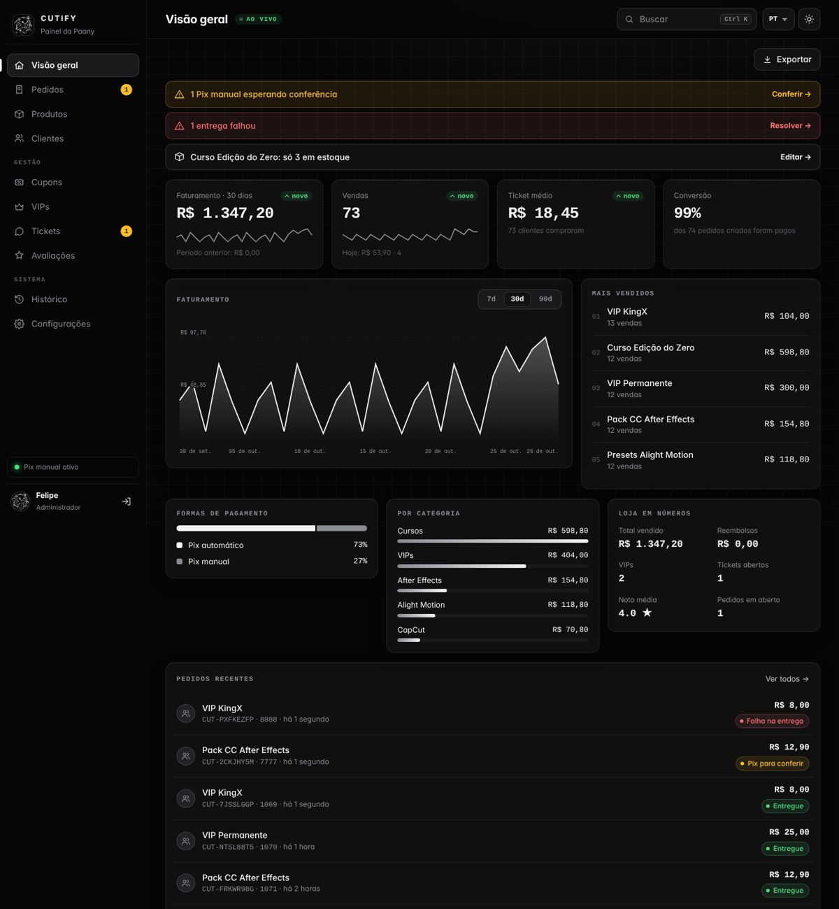
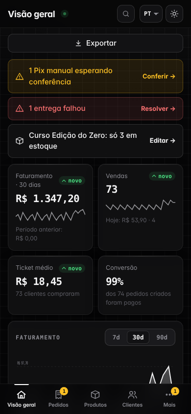
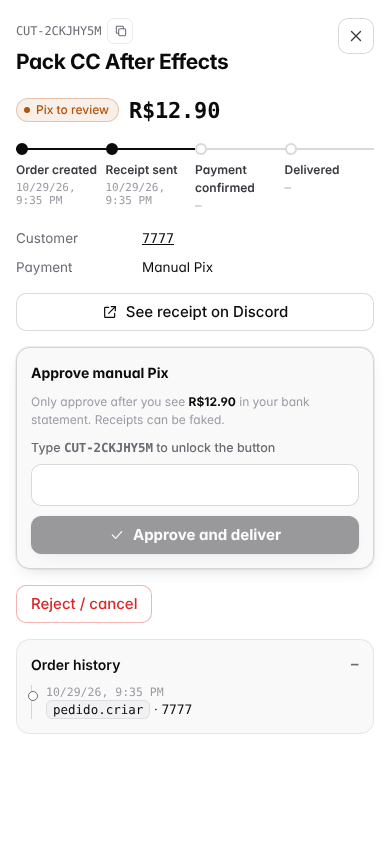
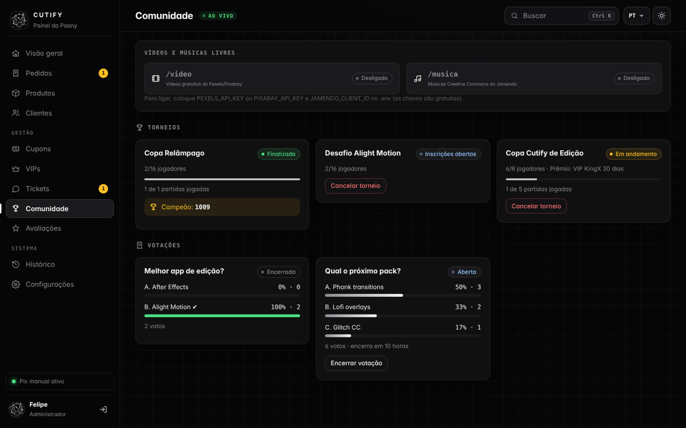
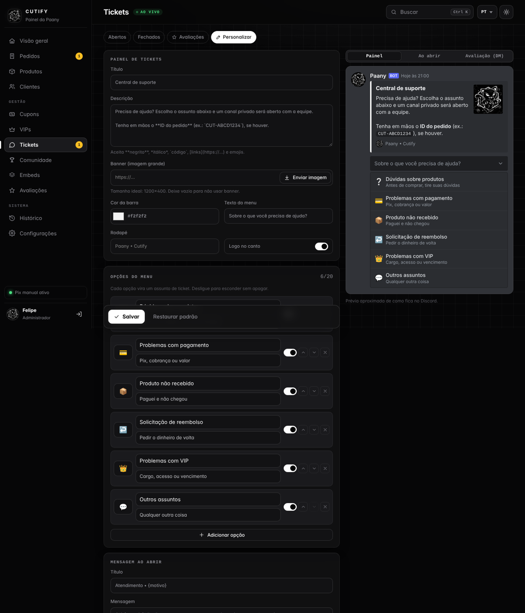
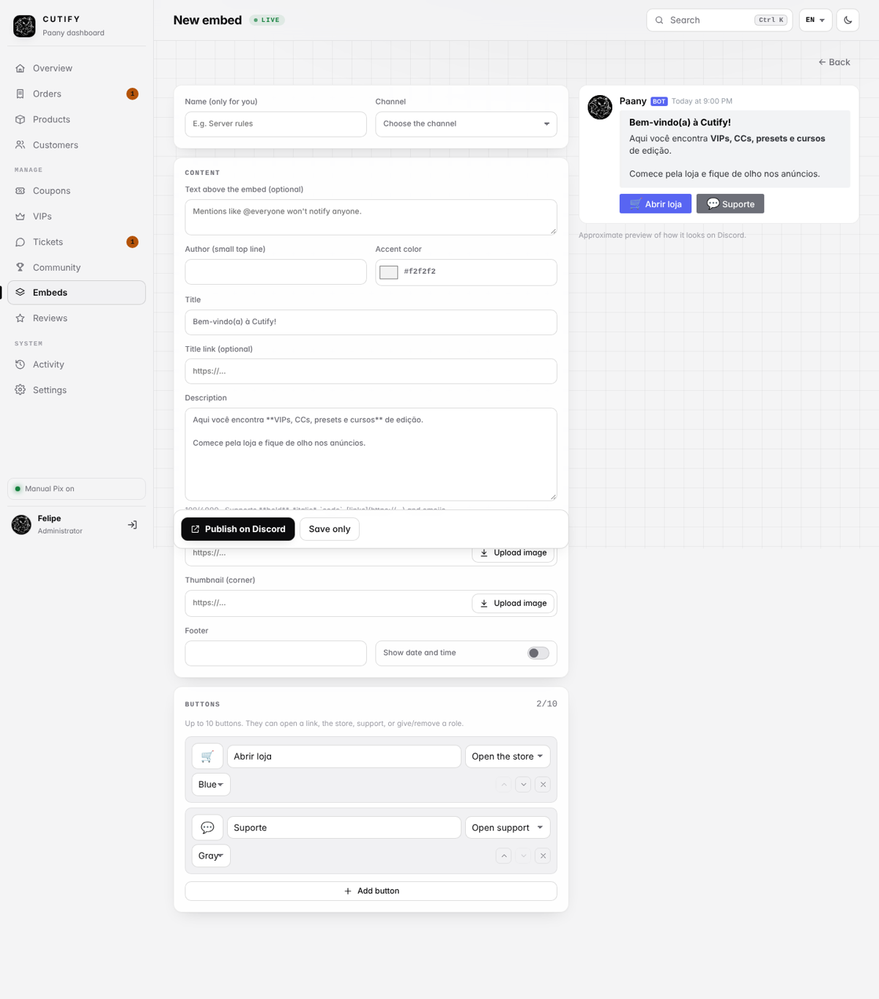

# Paany — Bot de vendas da Cutify

Bot de Discord que vende VIPs, CCs, presets e cursos da **Cutify** com Pix, entrega automática, tickets e painel administrativo. Visual preto e branco com o gatinho da marca.

## O que ele faz

- **Loja**: vitrine com categorias (VIP, After Effects, Alight Motion, Node, CapCut, Cursos, Personalizados), busca, detalhes, estoque e imagem.
- **Pix automático (Mercado Pago)**: QR Code + copia e cola. O bot confere o pagamento direto na API do Mercado Pago (valor, moeda, pedido e status) e entrega sozinho.
- **Pix manual**: gera o QR Code da sua chave com o valor exato. O cliente envia o comprovante num canal privado e **a equipe aprova só depois de ver o dinheiro no extrato** (o comprovante nunca libera nada sozinho).
- **Entrega automática**: dá o cargo VIP e manda o link/arquivo/instruções na DM. Se a DM estiver fechada, o cliente vê em `/meuspedidos`. Se falhar, a equipe reenvia sem cobrar de novo.
- **VIP com prazo**: avisa antes de vencer, tira o cargo no vencimento e soma os dias quando o cliente renova.
- **Cupons e promoções**: % ou valor fixo, limite de usos, validade, início agendado, uso único por cliente, cupom só para um produto.
- **Tickets**: dúvidas, pagamento, produto não recebido, reembolso, VIP e outros, com transcrição salva ao fechar.
- **Painel admin**: vendas do dia/semana/total, faturamento, reembolsos, mais vendidos, pendências, falhas de entrega e histórico de ações.
- **Avaliações**: depois da entrega o cliente dá nota de 1 a 5 e um comentário. A avaliação vai para um canal de feedbacks e a nota média aparece na loja.
- **Renovação com 1 clique**: o aviso de VIP vencendo chega na DM com o botão **Renovar agora**, que já abre a compra do mesmo plano.
- **Painel web** (hospedagem paga): login com Discord, em português, inglês ou espanhol, tema escuro e claro, funciona no celular. Vendas, pedidos, clientes, produtos, cupons, VIPs, tickets, avaliações, configurações e busca rápida. Veja a seção 6.
- **Pausar a loja**: modo manutenção ligado pelo painel, que bloqueia novas compras no Discord.
- **Torneios**: inscrição por botão, chave eliminatória sorteada (quem sobra passa direto), resultados reportados pela equipe e anúncio do campeão.
- **Votações**: até 10 opções com botões, barras de resultado ao vivo, prazo automático, voto restrito a um cargo e opção de esconder o resultado até o fim.
- **Vídeos e músicas livres**: `/video` busca vídeos gratuitos (Pexels/Pixabay) e `/musica` busca músicas Creative Commons (Jamendo), com crédito e licença de cada item.
- **Tickets personalizáveis**: título, descrição, banner, cor, texto do menu, opções com emoji e mensagem de boas-vindas, editados pelo Discord ou pelo painel web (com prévia ao vivo).
- **Avaliação do atendimento**: quando o ticket fecha, quem abriu recebe na DM botões de 1 a 5 estrelas e pode comentar. A nota vai para o canal escolhido pelo admin, e o painel mostra a média e o ranking da equipe.
- **Embeds com botões**: crie mensagens bonitas com até 10 botões (link, abrir loja, abrir suporte ou dar/tirar cargo) pelo `/embed` ou pelo editor visual do painel.
- **Proteções**: pedidos duplicados reaproveitados, eventos de pagamento processados uma vez só, entrega com trava contra duplicidade, limite de pedidos abertos, anti-spam, permissões checadas pelo ID do admin no servidor, clientes só veem os próprios pedidos.

---

## 1. Criar o bot no Discord

1. Acesse **https://discord.com/developers/applications** → **New Application** → nome **Paany**.
2. Em **General Information**, copie o **Application ID** (vai em `DISCORD_CLIENT_ID`) e coloque o logo do gatinho como ícone.
3. Aba **Bot**:
   - **Reset Token** → copie (vai em `DISCORD_TOKEN`). Não mostre para ninguém.
   - Ligue **Server Members Intent** e **Message Content Intent** (este último é para salvar a transcrição dos tickets).
4. Convide o bot (troque `SEU_CLIENT_ID`):

   ```
   https://discord.com/oauth2/authorize?client_id=SEU_CLIENT_ID&scope=bot+applications.commands&permissions=268553232
   ```

   Permissões incluídas: Gerenciar cargos, Gerenciar canais, Ver canais, Enviar mensagens, Inserir links, Anexar arquivos e Ler histórico.
5. No servidor: **Configurações → Cargos** e arraste o cargo **Paany** para **acima** dos cargos VIP que ele vai dar.
6. Ative o **Modo desenvolvedor** (Configurações do usuário → Avançado) para copiar IDs com o botão direito:
   - ID do servidor → `DISCORD_GUILD_ID`
   - Seu ID → `ADMIN_IDS` (vários separados por vírgula)
   - ID do cargo da equipe → `STAFF_ROLE_ID`

## 2. Configurar os pagamentos

### Pix automático — Mercado Pago (recomendado)

1. Crie uma aplicação em **https://www.mercadopago.com.br/developers/panel/app**.
2. Em **Credenciais de teste**, copie o Access Token (`TEST-...`) para testar primeiro.
3. Quando estiver tudo certo, troque pelo **Access Token de produção** (`APP_USR-...`).
4. Preencha `MP_ACCESS_TOKEN` e `MP_PAYER_EMAIL` (um e-mail da loja).
5. Sua conta precisa ter uma **chave Pix cadastrada** no Mercado Pago.

O bot confere os Pix pendentes a cada 20 segundos, então funciona em hospedagem grátis sem webhook. Se um dia usar hospedagem paga com endereço público, configure também `PUBLIC_URL` e `MP_WEBHOOK_SECRET` (painel do Mercado Pago → Webhooks → evento *Pagamentos*, URL `https://seu-endereco/webhook/mercadopago`) para a confirmação ficar instantânea.

### Pix manual

Preencha `PIX_KEY`, `PIX_NAME` e `PIX_CITY` exatamente como estão no seu banco. Nos pedidos de Pix manual:

1. O cliente paga e clica em **Já paguei**.
2. Abre um canal privado para ele mandar o comprovante, e o pedido aparece no canal de **aprovações**.
3. Você abre o app do banco, **confere se o valor caiu**, clica em **Aprovar** e digita o ID do pedido para confirmar.
4. O bot entrega na hora.

> Comprovante pode ser editado. Só aprove o que você viu no extrato.

Você pode usar os dois métodos juntos, ou só um — o botão do que não estiver configurado some sozinho.

## 3. Rodar no seu computador (para testar)

Precisa do **Node.js 22.13 ou mais novo** (https://nodejs.org).

```bash
npm install
cp .env.example .env      # no Windows: copy .env.example .env
# edite o .env com seus dados
npm run deploy            # registra os comandos no servidor (repita se mudar comandos)
npm start
```

`npm test` roda os testes da lógica de pedidos, cupons, Pix, Mercado Pago e do painel web.

## 4. Hospedar grátis na Discloud

O plano grátis da Discloud dá 100 MB de RAM para 1 bot, sem site público — por isso o bot usa a verificação automática a cada 20 s em vez de webhook. O projeto já vem com caches reduzidos para caber nesse limite.

1. Crie conta em **https://discloud.com** e entre no Discord deles para liberar o plano.
2. No seu computador, rode `npm run deploy` uma vez (registra os comandos).
3. Monte um **.zip** com: `src/`, `assets/`, `package.json`, `discloud.config` e o seu `.env`. **Não** inclua `node_modules/` nem `data/`.
4. Envie o .zip pelo painel ou pelo comando `/upload` do bot da Discloud.
5. Para atualizar, envie um novo .zip com o comando de *commit*.

> **Backups**: o banco fica em `data/paany.db` e o bot faz uma cópia por dia em `data/backups/`. Use `/admin backup` de vez em quando para baixar uma cópia — se a hospedagem apagar os arquivos, você restaura colocando o arquivo em `data/paany.db`.

Se o bot crescer, qualquer hospedagem paga com Node 22 funciona igual (Square Cloud, VPS etc.). Nela você liga o **painel web** e o **webhook** (seção 6).

## 5. Primeiros passos no Discord

1. `/configurar canais` — escolha os canais de **vendas**, **admin**, **erros**, **aprovações** e a **categoria dos tickets** (deixe esses canais visíveis só para a equipe). Escolha também o canal de **avaliações**, que pode ser público.
2. `/produto adicionar` — preencha nome, preço, categoria e tipo de entrega. Abre um formulário para descrição, regras e o **conteúdo privado** (link do Drive/Mega, instruções). Para VIP escolha o **cargo** e os **dias** (vazio = permanente).
3. No canal da loja: `/configurar painel-loja`.
4. No canal de suporte: `/configurar painel-suporte`.
5. `/configurar termos` para ajustar termos, reembolso e privacidade.
6. Faça uma compra de teste com o token `TEST-` do Mercado Pago e com o Pix manual.

Imagens de produto precisam ser **links diretos** (`https://...png`). Links de anexo do Discord expiram, então prefira um serviço como o Imgur.

## 6. Painel web

O painel precisa de um endereço público na internet, então **não funciona no plano grátis da Discloud**. Use, por exemplo, a **Square Cloud** (plano Hobby) ou uma VPS.

**O que tem no painel**

| Tela | O que faz |
|---|---|
| **Visão geral** | Faturamento, vendas, ticket médio e conversão com comparação ao período anterior, gráfico interativo (7, 30 ou 90 dias), mais vendidos, formas de pagamento, vendas por categoria e alertas de Pix para conferir, entregas com falha e estoque baixo |
| **Pedidos** | Busca, filtros por situação, linha do tempo de cada pedido, aprovar Pix manual (digitando o ID), recusar, reenviar entrega e reembolsar |
| **Produtos** | Busca, filtro por categoria, mostrar/ocultar com um toque, duplicar, editar com upload de imagem que não expira |
| **Clientes** | Quem mais compra, total gasto, ficha completa com pedidos, VIPs, avaliações e tickets |
| **Cupons** | Cartões com uso e validade, gerador de código, início e fim agendados |
| **VIPs** | Quem tem VIP e quando vence (destaque para os que vencem em 3 dias) |
| **Tickets** | Abertos e fechados, com atalho para o canal no Discord |
| **Avaliações** | Nota média, distribuição de estrelas e opção de ocultar |
| **Histórico** | Todas as ações, com busca |
| **Configurações** | Pausar a loja (modo manutenção), editar os termos, ver pagamentos e canais, status do sistema e baixar backup |

Extras:

- **3 idiomas**: português, inglês e espanhol (troca no topo; as mensagens do servidor também mudam).
- **Tema escuro e claro**, lembrado por navegador.
- **Busca rápida** com `Ctrl+K` (`⌘K` no Mac): pedidos, produtos, clientes, páginas e ações.
- **Ao vivo**: confere pendências a cada 30 segundos e avisa quando chega um Pix novo para conferir.
- **Celular**: menu embaixo da tela, tabelas viram cartões, gavetas em tela cheia. Dá para instalar como app pela opção "Adicionar à tela inicial".
- **Pausar a loja**: bloqueia novas compras no Discord (a vitrine continua visível) e mostra sua mensagem aos clientes.

<p align="center">
  <br>
  
  <br>
  <br>
  <br>
  
</p>

**Segurança do painel**

- Só entra quem está em `ADMIN_IDS`, e isso é conferido a cada clique. Se você tirar alguém da lista, a pessoa perde o acesso assim que o bot reiniciar com a lista nova.
- Login pelo Discord: o painel nunca vê a senha de ninguém.
- A sessão dura 12 horas e fica num cookie assinado com o `PANEL_SECRET`.
- Toda ação que altera dados exige um código da sessão, o que impede outro site de agir em seu nome.
- O conteúdo privado dos produtos só aparece no formulário de edição, nunca nas listas.
- Cada ação feita pelo painel aparece nos logs do Discord com a marcação "(painel web)".

**Como ligar o painel**

1. **Developer Portal → sua aplicação → OAuth2**:
   - Copie o **Client Secret** para `DISCORD_CLIENT_SECRET`.
   - Em **Redirects**, adicione `https://SEU-ENDERECO/auth/callback` e salve.
2. Gere o `PANEL_SECRET`:
   ```bash
   node -e "console.log(require('crypto').randomBytes(32).toString('hex'))"
   ```
3. No `.env`, preencha `PUBLIC_URL` (sem barra no final), `DISCORD_CLIENT_SECRET` e `PANEL_SECRET`.
4. Acesse `https://SEU-ENDERECO/painel` e entre com o Discord.

**Hospedar na Square Cloud**

1. O projeto já vem com o arquivo `squarecloud.config`. Troque `SUBDOMAIN=cutify` se esse nome já estiver em uso.
2. No `.env`, use `PORT=80` e `PUBLIC_URL=https://cutify.squareweb.app` (com o seu subdomínio).
3. Monte o .zip com `src/`, `assets/`, `package.json`, `squarecloud.config` e `.env`. Não inclua `node_modules/` nem `data/`.
4. Envie pelo painel da Square Cloud.

**Webhook do Mercado Pago (opcional, recomendado)**

Com endereço público, o Pix passa a ser confirmado na hora:

1. No painel do Mercado Pago, abra a sua aplicação e vá em **Webhooks**.
2. Use a URL `https://SEU-ENDERECO/webhook/mercadopago` e marque o evento **Pagamentos**.
3. Copie a **assinatura secreta** para `MP_WEBHOOK_SECRET`.

A verificação a cada 20 segundos continua ligada como reserva.

## 7. Comunidade: torneios, votações, vídeos e músicas

**Torneios** (a equipe cria; todos participam)

1. No canal do evento: `/torneio criar nome:Copa Cutify vagas:16 premio:VIP 30 dias`.
2. A mensagem do torneio aparece com os botões **Inscrever-se** e **Sair**, e a lista de inscritos se atualiza sozinha.
3. A equipe clica em **Iniciar** (ou usa `/torneio iniciar`). O bot sorteia a chave. Se o número de jogadores não fechar (ex.: 6), alguns passam direto para a rodada seguinte.
4. Quando uma partida termina, a equipe clica em **Reportar resultado**, escolhe a partida e o vencedor. A chave avança sozinha.
5. Na final, o bot anuncia o campeão e o prêmio no canal.

Também tem `/torneio chave` (qualquer um vê a chave) e `/torneio cancelar`. O torneio funciona de 2 a 64 jogadores.

**Votações** (a equipe cria)

```
/votacao criar pergunta:Qual o próximo pack? opcoes:Phonk | Lofi | Glitch duracao_min:1440
```

- Cada membro vota clicando no botão da opção. Clicar em outra opção troca o voto, e clicar na mesma retira.
- **Meu voto** mostra em qual opção a pessoa votou, sem expor o voto dos outros.
- `cargo:` limita quem vota (ex.: só VIPs). `ocultar_resultado:true` mostra o resultado só no fim.
- Com `duracao_min`, a votação encerra sozinha e o bot anuncia a opção vencedora. Também dá para encerrar pelo botão, por `/votacao encerrar` ou pelo painel.

**Vídeos e músicas livres** (todos usam)

- `/video busca:smoke formato:Vertical`: vídeos gratuitos do Pexels ou Pixabay, liberados até para uso comercial. Mostra a prévia, a resolução e o botão **Baixar vídeo**.
- `/musica busca:lofi`: músicas Creative Commons do Jamendo. Mostra a licença, o botão **Ouvir** e, quando o artista permite, **Baixar MP3**. Avisa quando a licença é **não comercial** (não pode ir para vídeo monetizado).
- As respostas aparecem só para quem pediu. Com `publico:true`, aparecem para o canal todo. Use ◀ ▶ para ver mais resultados.
- Para ligar, crie as chaves gratuitas e coloque `PEXELS_API_KEY` ou `PIXABAY_API_KEY`, além de `JAMENDO_CLIENT_ID`, no `.env` (veja o `.env.example`).

> O bot **não** baixa vídeos ou músicas do YouTube, TikTok, Spotify e afins: isso viola os termos dessas plataformas e direitos autorais, e pode fazer o Discord banir o bot ou o servidor.

No painel web, a tela **Comunidade** mostra os torneios (progresso e campeão), as votações (resultado parcial) e se a busca de mídia está ligada, com botões para cancelar um torneio ou encerrar uma votação.

## 8. Tickets personalizados, avaliação e embeds

**Personalizar o painel de tickets**

- **Pelo painel web**: Tickets → **Personalizar**. Edite título, descrição, banner (com upload), cor, texto do menu, rodapé e as opções do menu (nome, descrição, emoji, ordem, mostrar/ocultar). A prévia ao lado mostra como fica no Discord: o painel, a mensagem ao abrir o ticket e a avaliação na DM.
- **Pelo Discord**:
  - `/ticket personalizar`: título, descrição, banner, cor e texto do menu.
  - `/ticket opcao`: cria uma opção nova (deixe "opcao" vazio) ou edita/oculta/remove uma existente. Aceita emoji comum (🤝) ou do servidor (`<:nome:id>`).
  - `/ticket boas-vindas`: mensagem que aparece quando o ticket abre. Use `{usuario}`, `{motivo}` e `{servidor}`.
  - `/ticket publicar canal:#suporte`: publica o painel. Depois disso, **toda mudança atualiza a mensagem sozinha**.
  - `/ticket restaurar`: volta tudo ao padrão.

**Avaliação do atendimento**

1. Escolha o canal das notas: `/ticket avaliacao ativa:true canal:#avaliacoes-suporte` (ou `/configurar canais avaliacoes_atendimento:`, ou pelo painel).
2. Quando alguém da equipe clica em **Assumir**, o bot registra quem está atendendo.
3. Ao **Fechar ticket**, quem abriu recebe na DM o pedido de avaliação com botões de 1 a 5 ★. Depois de escolher, pode deixar um comentário.
4. A avaliação é publicada no canal escolhido (cliente, atendente, assunto, nota e comentário). Cada atendimento só pode ser avaliado uma vez, e só por quem abriu.
5. `/ticket notas` e a aba **Avaliações** do painel mostram a média e o ranking da equipe.

Se a DM do cliente estiver fechada, o bot avisa a equipe na mensagem de fechamento.

**Embeds com botões**

- **Pelo painel web** (recomendado): menu **Embeds**. Comece de um modelo (Regras, Boas-vindas, Anúncio, Cargos por botão) ou do zero, edite com prévia ao vivo e clique em **Publicar no Discord**. Editar depois atualiza a mesma mensagem.
- **Pelo Discord**: `/embed criar canal:#regras` abre um formulário. No campo de botões, escreva um por linha:

  ```
  🌐 Site | https://cutify.com
  Comprar | loja
  Suporte | ticket
  Avisos | cargo Notificações
  ```

  `/embed editar` reabre o formulário preenchido, `/embed reenviar` publica de novo (em outro canal ou se a mensagem foi apagada) e `/embed apagar` remove.
- **O que cada botão faz**: *link* abre o site; *loja* abre a vitrine só para quem clicou; *ticket* abre o menu de suporte; *cargo* dá o cargo (ou tira, se a pessoa já tiver).
- Por segurança, **cargos com permissões de moderação** (administrador, banir, gerenciar canais etc.) não podem ser dados por botão, e o cargo do bot precisa estar acima do cargo distribuído.

## Comandos

| Clientes | |
|---|---|
| `/loja` | Abre a loja (com filtro de categoria ou busca) |
| `/comprar` | Compra direto pelo nome, com cupom opcional |
| `/meuspedidos` | Lista os próprios pedidos |
| `/pedido` | Consulta um pedido próprio pelo ID |
| `/suporte` | Abre um ticket |
| `/ajuda` • `/termos` | Comandos e termos |
| `/video` • `/musica` | Vídeos e músicas livres para edição |
| `/torneio chave` | Ver a chave de um torneio |

| Administradores (só IDs em `ADMIN_IDS`) | |
|---|---|
| `/admin painel` • `logs` • `backup` | Resumo, histórico de ações e backup do banco |
| `/produto adicionar` • `editar` • `remover` • `listar` • `estoque` | Catálogo |
| `/gpedido consultar` • `aprovar` • `reenviar` • `cancelar` • `reembolsar` • `cliente` • `pendentes` | Pedidos |
| `/cupom criar` • `listar` • `desativar` | Cupons e promoções |
| `/vendas` | Relatório por período |
| `/vip listar` • `dar` • `remover` | VIPs |
| `/torneio criar` • `iniciar` • `cancelar` | Torneios (equipe: admins ou cargo de staff) |
| `/votacao criar` • `encerrar` | Votações (equipe) |
| `/ticket personalizar` • `boas-vindas` • `opcao` • `avaliacao` • `publicar` • `notas` • `restaurar` | Painel de tickets e avaliação do atendimento |
| `/embed criar` • `editar` • `reenviar` • `apagar` • `listar` | Embeds com botões |
| `/configurar canais` • `painel-loja` • `painel-suporte` • `termos` • `ver` | Configuração (inclui o canal de avaliações) |

**Reembolso**: no Pix automático o estorno é feito pelo Mercado Pago na hora. No Pix manual o bot marca como reembolsado e você devolve pelo app do banco. Por padrão o cargo VIP é retirado.

## Situações dos pedidos

Aguardando pagamento → (Em análise, no Pix manual) → Pagamento confirmado → Em processamento → **Entregue**.
Outras: Cancelado, Expirado, Falha na entrega (equipe avisada, reenvio sem nova cobrança), Reembolsado.

## Checklist de testes antes de vender

- [ ] Compra aprovada no Pix automático (token `TEST-`) → produto chega na DM
- [ ] Pix não pago → pedido expira depois de 30 min
- [ ] Clicar em pagar várias vezes → reaproveita o mesmo pedido
- [ ] Pix manual aprovado → entrega; recusado → cliente recebe o motivo
- [ ] DM fechada → cliente vê o produto em `/meuspedidos`
- [ ] Cargo do bot abaixo do VIP → falha registrada → corrigir e clicar em **Tentar entregar de novo**
- [ ] VIP de 1 dia → aviso e remoção do cargo
- [ ] Membro comum tentando `/admin` → acesso negado e registrado
- [ ] Cupom usado duas vezes pelo mesmo cliente → bloqueado
- [ ] Avaliar uma compra entregue → aparece no canal de avaliações e na loja
- [ ] Painel: entrar com uma conta de admin e com uma conta comum (deve ser negada)
- [ ] Painel: aprovar um Pix manual e conferir a entrega no Discord
- [ ] Torneio com 3 contas: inscrever, iniciar, reportar e ver o campeão
- [ ] Votação com prazo de 1 minuto: votar, trocar o voto e ver o encerramento automático
- [ ] `/video` e `/musica` com as chaves configuradas
- [ ] Personalizar o painel de tickets e ver a mensagem publicada se atualizar
- [ ] Assumir e fechar um ticket com outra conta: chega a DM, a nota vai para o canal
- [ ] Embed com botão de cargo: clicar dá o cargo, clicar de novo tira

## Segurança

- Tokens e chaves só no `.env` (já está no `.gitignore`).
- O bot não guarda dados de cartão nem senhas — só o ID do Discord e o histórico de pedidos.
- Conteúdo privado dos produtos só aparece para quem pagou, e nunca vai para os logs.
- Os logs e o backup ficam só com a equipe: o backup contém os links privados.

## Estrutura

```
src/
  index.js              inicia o bot e as rotinas
  deploy.js             registra os comandos
  config.js  db.js  theme.js  util.js
  commands/definitions.js
  handlers/  router.js (distribui)  client.js (clientes)  admin.js (administração)
             community.js (torneios, votações, mídia)  customize.js (/ticket, /embed)
  services/  orders.js (regras)  payments.js  mercadopago.js  pix.js
             delivery.js  vip.js  tickets.js  reviews.js  actions.js
             tournaments.js  polls.js  media.js  ticketConfig.js  embeds.js
             webhook.js  backup.js  logger.js
  ui/store.js  support.js   telas da loja e painel de suporte
  web/       server.js (HTTP)  auth.js (login Discord)  api.js  i18n.js (mensagens)
             public/ index.html  app.js  app.css  i18n.js (textos PT/EN/ES)
assets/  logo.png  banner.png
docs/    capturas de tela
tests/   core.test.js  web.test.js  community.test.js  customize.test.js
```
